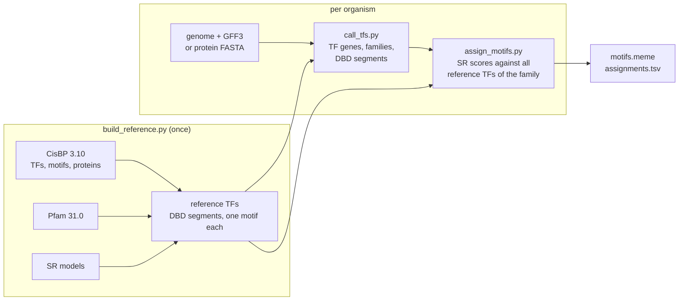

# igem-pwm-assignment

Inference of transcription factor DNA-binding specificities for eukaryotic proteomes,
using Similarity Regression and the reference data of the CisBP database.

## Overview

igem-pwm-assignment identifies the transcription factors (TFs) encoded in a eukaryotic
proteome and infers a DNA-binding motif for each TF whose DNA-binding domains (DBDs)
are sufficiently similar to those of a TF with an experimentally determined motif. The
inference follows the procedure CisBP applies to its own catalogue: Similarity
Regression (SR) scoring, the family-specific SR models and the family-specific cutoffs
are taken unchanged from CisBP build 3.10 and the published SR implementation.

The input is either a genome assembly with a GFF3 gene annotation or a protein FASTA
file. The output consists of (i) a motif file in
[MEME format](https://meme-suite.org/meme/doc/meme-format.html) and (ii) a table
reporting, for each TF, the inferred motif, the reference TF from which it was
transferred, the SR score and its margin above the family cutoff.

The software was developed as an iGEM software project for the filamentous fungus
*Trichoderma atroviride* strain P1. The method is not specific to fungi.

> Inferred motifs are predictions based on DBD sequence similarity; they do not
> constitute experimental evidence of binding. TFs without a sufficiently similar
> reference TF are not assigned a motif.

## Contents

- [Motivation](#motivation)
- [Background](#background)
- [Workflow](#workflow)
- [Installation](#installation)
- [Usage](#usage)
- [Configuring a new organism](#configuring-a-new-organism)
- [Outputs](#outputs)
- [Interpretation](#interpretation)
- [Validation](#validation)
- [Known limitations](#known-limitations)
- [Repository layout](#repository-layout)
- [References](#references)
- [License](#license)

## Motivation

Genome-wide prediction of TF binding sites requires the DNA-binding specificity of each
TF, usually represented as a position weight matrix (PWM, referred to here as a motif).
Experimentally determined motifs are available for only a few thousand TFs,
concentrated in a small number of model organisms. CisBP extends this coverage by
transferring experimentally determined motifs to TFs with highly similar DBDs, and
provides such inferences for 741 species.

These precomputed inferences are tied to the gene models and identifiers used by
CisBP. For *T. atroviride*, CisBP lists TFs under the JGI draft annotation
(`TRIATDRAFT_*` identifiers), which cannot be mapped directly onto the RefSeq
annotation of strain P1 (`TrAtP1_*` identifiers). The same limitation applies to any
newly sequenced strain or re-annotated genome. igem-pwm-assignment repeats CisBP's
inference on a supplied proteome with CisBP's own reference data, models and cutoffs,
so that the results remain directly comparable to those of CisBP.

## Background

**DNA-binding specificity.** TFs recognise DNA through one or more DBDs, such as the
homeodomain or the C2H2 zinc finger. The sequence preference of a TF is commonly
represented as a PWM, which gives the probability of each nucleotide at each position
of the binding site. TFs with highly similar DBDs generally have highly similar
specificities ([Weirauch et al. 2014](https://doi.org/10.1016/j.cell.2014.08.009)),
which is the basis for transferring motifs between related TFs.

**CisBP** ([cisbp.ccbr.utoronto.ca](https://cisbp.ccbr.utoronto.ca/), Catalog of
Inferred Sequence Binding Preferences) is a curated database of TF motifs. Build 3.10,
used here, contains approximately 392,000 TFs from 741 species, of which 4,989 have at
least one directly determined motif (e.g. from protein-binding microarrays or
HT-SELEX). For the remaining TFs, CisBP either reports an inferred motif or records that
no inference is possible. TFs are grouped into families according to their DBD
composition, and each family is assigned a similarity cutoff for motif inference.

**Similarity Regression** ([Lambert et al. 2019](https://doi.org/10.1038/s41588-019-0411-1);
implementation: [github.com/smlmbrt/SimilarityRegression](https://github.com/smlmbrt/SimilarityRegression))
is the method CisBP uses for motif inference. For each DBD family, SR fits a linear model
on pairs of TFs with experimentally determined motifs, learning one weight per match
state of the family's Pfam domain model that reflects the contribution of that position
to binding specificity. The SR score of two DBDs is thus a position-weighted sequence
identity (or BLOSUM62 similarity, depending on the family model). Pairs scoring at or above the family cutoff are classified as highly similar
(HSim); the cutoffs were selected to give at least 75% precision on held-out data. A TF
is assigned the motif of the highest-scoring HSim reference TF.

**Pfam and HMMER.** DBDs are detected with [HMMER](http://hmmer.org/)
([Eddy 2011](https://doi.org/10.1371/journal.pcbi.1002195)) and the profile hidden
Markov models of [Pfam](https://www.ebi.ac.uk/interpro/entry/pfam/)
([Mistry et al. 2021](https://doi.org/10.1093/nar/gkaa913)). Because SR weights are
defined per match state of a Pfam model, the Pfam release must correspond to the one on
which the SR models were trained. Pfam 31.0 is the only release whose model lengths
agree with all positional SR models; this is asserted each time the reference is built.

## Workflow



1. **Reference construction** (`build_reference.py`, performed once for all organisms).
   CisBP 3.10, Pfam 31.0 and SR are downloaded. Every CisBP TF with an experimentally
   determined motif becomes a reference TF: one protein isoform is selected, its DBDs
   are detected and aligned to the Pfam models (the input representation required by
   SR), and one of its motifs is designated for transfer.
2. **TF identification** (`call_tfs.py`, per organism). Annotated coding sequences are
   translated (or the supplied protein sequences are read), all proteins are scanned for
   DBDs, and a gene is classified as a TF if it encodes a DBD passing the Pfam gathering
   threshold. Each TF gene is represented by one protein and assigned the CisBP family
   defined by its DBD types.
3. **Motif assignment** (`assign_motifs.py`, per organism). Each TF is scored against
   all reference TFs of its family with the corresponding SR model. If an HSim reference
   TF with a motif exists, the motif of the highest-scoring one is assigned; otherwise
   no motif is assigned.
4. **Method verification** (`check_sr_vs_cisbp.py`, optional). The published SR example
   is reproduced, and the pipeline's decisions are compared with CisBP's own inferences
   for six fungal species.

All external files are downloaded once into `data/raw/` and recorded with their SHA-256
checksums. Each output directory contains a provenance record (code version, tool
versions, input checksums and settings). A rerun from `data/raw/` reproduces all outputs
byte for byte.

The decision rules (TF classification, isoform and motif selection) and their
justification are documented in [scripts/README.md](scripts/README.md#method-rules).

## Installation

The pipeline was developed and tested on Linux. It requires
[conda](https://docs.conda.io/) or [mamba](https://mamba.readthedocs.io/), as well as
`curl` and `git`.

```bash
git clone https://github.com/ajanowiak/igem-pwm-assignment.git
```

```bash
cd igem-pwm-assignment
```

```bash
mamba env create -y -f environment.yml
```

```bash
conda activate igem-pwm-assignment
```

The environment provides Python 3.12, HMMER 3.4, gffread 0.12, Biopython, pandas and
numpy. JupyterLab and matplotlib are included for exploratory notebooks only.

## Usage

The complete pipeline is run with:

```bash
bash run_pipeline.sh
```

This builds the reference and processes every organism configured in `config/`
(*T. atroviride* P1 and *Neurospora crassa* OR74A are provided). A single organism is
processed by naming its configuration file; the option `--check` adds the comparison
with CisBP's own inferences:

```bash
bash run_pipeline.sh tatroviride_p1.toml
```

```bash
bash run_pipeline.sh --check
```

The first run downloads approximately 290 MB (CisBP, Pfam, SR and the two example
genomes); subsequent runs reuse these files. With all downloads present, a complete run
including `--check` takes approximately three minutes on a desktop workstation. Progress
is reported on standard output and written to `logs/`. The individual scripts and their
options are described in [scripts/README.md](scripts/README.md).

## Configuring a new organism

A new organism is added by creating a configuration file in `config/`, based on one of
the supplied examples:

- `config/tatroviride_p1.toml`: genome and annotation from NCBI RefSeq
- `config/ncrassa.toml`: genome and annotation from Ensembl Fungi

```toml
[organism]
name = "Trichoderma atroviride"
strain = "P1"
label = "tatroviride_p1"          # name of the output directory results/<label>/

[input]
genome = "https://.../genomic.fna.gz"       # URL or local path, optionally gzipped
annotation = "https://.../genomic.gff.gz"   # GFF3 with CDS features
# alternatively, instead of genome and annotation:
# proteins = "path/to/proteins.faa"
```

The organism is then processed with `bash run_pipeline.sh <file>.toml`.

- For genome and GFF3 input, proteins are translated with gffread and grouped into genes
  by their parent gene feature. If the annotation contains no gene features, each
  transcript is treated as a separate gene and a warning is logged, since isoforms of
  one gene may then be counted more than once.
- For protein FASTA input, each record is treated as one gene; one protein per gene
  should therefore be supplied where possible.
- Translation uses the standard genetic code. Mitochondrially encoded proteins therefore
  usually contain internal stop codons; such proteins are excluded and their number is
  recorded in the provenance file.

Settings shared by all organisms (CisBP build, Pfam release, SR commit and thresholds)
are pinned in `config/reference.toml` and are not intended to be changed. The one
optional setting, `calling_i_evalue`, is described in
[scripts/README.md](scripts/README.md#configuration).

## Outputs

For each organism, `results/<label>/` contains:

| file | content |
|---|---|
| `motifs.meme` | each assigned motif once; identifiers are CisBP motif IDs (e.g. `M01613_3.10`), and the alternative name on each `MOTIF` line is the reference TF from which the motif was transferred |
| `assignments.tsv` | one row per TF gene: tier, motif, best reference TF with species and SR score, family cutoff and margin, runner-up reference TF, and the experiment and study in which the motif was determined |
| `tf_calls.tsv` | one row per TF gene: representative protein, detected DBDs, CisBP family |
| `dbd_hits.tsv` | all DBD hits reported by HMMER |
| `provenance_*.json` | code version, tool versions, input checksums and settings of each step |

Each TF gene is assigned to exactly one tier:

| tier | definition |
|---|---|
| `pass` | at least one reference TF is HSim (SR score at or above the family cutoff) and has a motif; the motif of the highest-scoring such TF is assigned |
| `below-threshold` | the TF was scored, but no reference TF reaches the cutoff; no motif is assigned |
| `none` | the TF could not be scored (no CisBP family for its DBD combination, no reference TF in its family, or no usable DBD segment); no motif is assigned |

The shared reference is written to `reference/cisbp_3.10_pfam_31.0/` and the method
verification to `results/checks/sr_vs_cisbp/`. All columns are defined in
[scripts/README.md](scripts/README.md#outputs).

The motif file specifies a uniform background. Because CisBP provides probabilities
rather than site counts, `nsites= 20` is a fixed weight and not a number of observed
sites, and `E= 0` is a placeholder. The value 20 is a convention, not derived from the
data. MEME-suite tools use `nsites` only to weight their pseudocount against the
probabilities (FIMO: `--motif-pseudo`, default 0.1). With 20, scores of good matches are
nearly unchanged, while mismatches at positions with probability near 0 are penalised
less than with a large `nsites`.

## Interpretation

- **Assigned motifs are predictions.** Lambert et al. (2019) report a held-out precision
  of approximately 0.8 for HSim pairs, with lower precision in some families, notably
  Zinc cluster TFs. This is a per-pair figure. A target TF passes if any reference TF
  of its family is HSim, as in CisBP's own inference, so the precision per target TF
  may be lower in families with many reference TFs (`n_references` in
  `assignments.tsv`).
- **Confidence increases with the margin.** `margin` is the SR score minus the family
  cutoff. In the method verification, agreement with CisBP is 47% for `pass` calls
  within 0.025 of the cutoff and 100% for calls more than 0.2 above it.
- **`below-threshold` indicates the absence of evidence,** not evidence of a distinct
  specificity.
- **Each motif is traceable to its source.** `best_reference_species` and the `motif_*`
  columns give the organism of the reference TF and the experiment in which the motif
  was determined.

## Validation

The following results were obtained with the current code on the stated datasets.

*T. atroviride* P1 (NCBI RefSeq GCF_020647795.1):
- gffread translations are identical to the NCBI protein FASTA for 13,567 of 13,568
  proteins.
- 431 TF genes: 109 `pass` (101 distinct motifs), 321 `below-threshold`, 1 `none`.

*N. crassa* OR74A (Ensembl Fungi release 63), a species included in CisBP:
- 231 TF genes, of which 228 are in CisBP's *N. crassa* TF list (290 TFs); the family
  agrees for 224 of the 228.
- 125 of the 156 *N. crassa* TFs with an experimentally determined motif in CisBP are
  identified; for 121 of these, the best-scoring reference TF is the TF itself, so its
  own motif is recovered.
- All 22 proteins excluded for internal stop codons are mitochondrially encoded.

Method verification (`check_sr_vs_cisbp.py`):
- The published SR homeodomain example is reproduced: 55 pairwise scores agree to within
  5e-7, with no classification differences, and 10 of 10 DBD alignments are identical
  to those distributed with SR.
- For 1,318 TFs of six fungal species, the pipeline assigns a motif to 94.6% of the TFs
  for which CisBP infers one (n = 296), and assigns none to 91.7% of the TFs for which
  CisBP infers none (n = 1,022). Disagreements are concentrated near the family cutoff.

## Known limitations

- **TF identification is more stringent than in CisBP.** A gene is classified as a TF
  only if a DBD passes the Pfam gathering threshold. For *N. crassa*, 62 of the 290 TFs
  listed by CisBP are not identified (31 of them with an experimentally determined
  motif); 61 of these have a DBD hit below the gathering threshold. A less stringent
  optional rule is available (`calling_i_evalue`).
- **Isoform selection.** CisBP lists all isoforms of a reference TF without indicating
  which one it scored. The pipeline selects one by a fixed rule, which may differ from
  CisBP's choice.
- **Missing reference sequences.** CisBP provides no protein sequence for 12 reference
  TFs whose motifs it transfers to other TFs; these motifs cannot be transferred here.
- **C2H2 zinc finger proteins.** The DBD segment rule frequently retains fewer zinc
  fingers than CisBP lists.
- **Sparse fungal reference data.** Most motifs transferred to fungal TFs originate from
  *N. crassa*, *Aspergillus nidulans*, *Saccharomyces cerevisiae* and *Fusarium
  graminearum*; most fungal Zinc cluster TFs are not assigned a motif.

## Repository layout

```
run_pipeline.sh          runs the complete pipeline
environment.yml          conda environment
config/                  reference.toml (pinned builds and rules); one .toml per organism
scripts/                 pipeline scripts; see scripts/README.md
scripts/srmotifs/        shared Python package; see scripts/srmotifs/README.md
data/raw/                downloaded files, write-once, listed in data/raw/SOURCES.tsv   (generated)
reference/               shared reference built from data/raw                         (generated)
results/                 one directory per organism, and checks/                      (generated)
logs/                    one log file per script run                                  (generated)
```

## References

When using this software, please cite CisBP and Similarity Regression, whose data and
method it applies:

- Lambert SA, Yang AWH, Sasse A, Cowley G, Albu M, Caddick MX, Morris QD, Weirauch MT,
  Hughes TR (2019). Similarity regression predicts evolution of transcription factor
  sequence specificity. *Nature Genetics* 51:981–989.
  [doi:10.1038/s41588-019-0411-1](https://doi.org/10.1038/s41588-019-0411-1)
- Weirauch MT, Yang A, Albu M, et al. (2014). Determination and inference of eukaryotic
  transcription factor sequence specificity. *Cell* 158:1431–1443.
  [doi:10.1016/j.cell.2014.08.009](https://doi.org/10.1016/j.cell.2014.08.009)

Software and databases used by the pipeline:

- Mistry J, Chuguransky S, Williams L, et al. (2021). Pfam: The protein families
  database in 2021. *Nucleic Acids Research* 49:D412–D419.
  [doi:10.1093/nar/gkaa913](https://doi.org/10.1093/nar/gkaa913)
- Eddy SR (2011). Accelerated profile HMM searches. *PLoS Computational Biology*
  7:e1002195. [doi:10.1371/journal.pcbi.1002195](https://doi.org/10.1371/journal.pcbi.1002195)
- Pertea G, Pertea M (2020). GFF Utilities: GffRead and GffCompare. *F1000Research*
  9:304. [doi:10.12688/f1000research.23297.2](https://doi.org/10.12688/f1000research.23297.2)
- Cock PJA, Antao T, Chang JT, et al. (2009). Biopython: freely available Python tools
  for computational molecular biology and bioinformatics. *Bioinformatics* 25:1422–1423.
  [doi:10.1093/bioinformatics/btp163](https://doi.org/10.1093/bioinformatics/btp163)

## License

This software is released under the GNU General Public License v3.0 (see
[LICENSE](LICENSE)). SimilarityRegression, also licensed under GPL-3.0, is downloaded at
a pinned commit and executed without modification. CisBP and Pfam data are downloaded
from their providers at run time and are not redistributed in this repository; their
respective terms of use apply.
